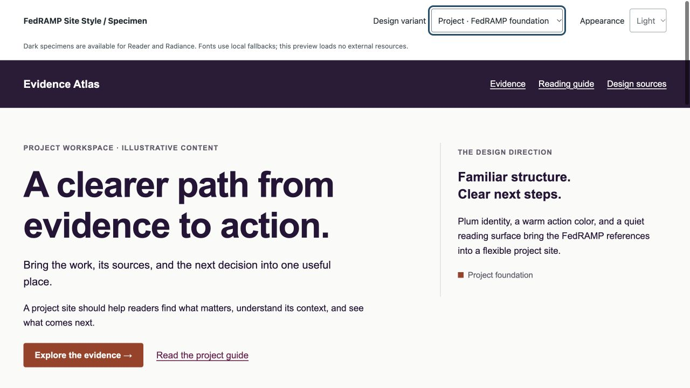

# FedRAMP Site Style

A reusable website-design skill based on FedRAMP.gov, the FedRAMP 2026 rules site and GitHub repository, and Pete Wai's research, report, workbook, and design-concept sites.

It applies the design language to an existing project while preserving its functionality, content, and identity. It does not assess FedRAMP compliance or confer official status.



## Use in a cloud or local chat

Paste this into the chat working on your site:

```text
Use the FedRAMP Site Style skill from:
https://github.com/gillooleyj/fedramp-site-style/tree/v1.0.0/skills/fedramp-site-style

Read SKILL.md and its relevant linked references, and retrieve the bundled assets as needed. If it is not listed as an installed skill, clone or download the repository and read the files directly. Choose the best variant for this project, make navigation clearer and the layout less crowded, and preserve existing functionality. Follow this project's existing instructions and verify the result.
```

This explicit URL/file workflow does not depend on the skill appearing in a picker. The environment needs access to this public GitHub repository (through its GitHub connection or network) or an attached copy of the files. A repository on GitHub does **not** automatically install or synchronize a skill across chats, computers, or cloud containers.

For FedRAMP Policy Atlas, the reference layout is a useful starting point, with the project palette available for a shared masthead. The skill should adapt to the existing graph, flow-chart, table, filters, and source details rather than replacing their behavior.

## Install for repeated local use

If the built-in skill installer is available, ask:

```text
$skill-installer install https://github.com/gillooleyj/fedramp-site-style/tree/v1.0.0/skills/fedramp-site-style
```

The bundled installer in the creating environment uses `$CODEX_HOME/skills` (normally `~/.codex/skills`). Other Codex versions document `~/.agents/skills` for user skills. Use the location supported by your environment rather than installing duplicate copies under both paths. The creator's Mac already has this skill installed; it does not need another copy.

## Keep the skill with a project

Copy the complete `skills/fedramp-site-style` directory into the target project's `.agents/skills/fedramp-site-style/`, preserving its references, assets, and `agents/openai.yaml`.

Run from the target project's root (requires Git and Python 3):

```sh
skill_checkout="$(mktemp -d)"
git clone --depth 1 --branch v1.0.0 https://github.com/gillooleyj/fedramp-site-style.git "$skill_checkout"
python3 - "$skill_checkout/skills/fedramp-site-style" "$PWD/.agents/skills/fedramp-site-style" <<'PY'
from pathlib import Path
import shutil
import sys
source, destination = map(Path, sys.argv[1:])
if not (source / 'SKILL.md').is_file():
    raise SystemExit('Skill source is missing; check the clone result.')
if destination.exists():
    raise SystemExit('A skill already exists here; compare it before updating.')
destination.parent.mkdir(parents=True, exist_ok=True)
shutil.copytree(source, destination)
print(f'Installed {destination}')
PY
```

Review and commit that folder if you want it carried with the project into future checkouts. Codex documents `.agents/skills` for repository discovery; cloud discovery and available skill controls can differ by environment. A direct request to read `.agents/skills/fedramp-site-style/SKILL.md` remains the fallback when the picker does not list it.

Optionally add this task-scoped instruction to the target project's existing `AGENTS.md`:

```md
For requested FedRAMP-style website design work, read
`.agents/skills/fedramp-site-style/SKILL.md` and its relevant references.
```

Reference: [OpenAI skill authoring and discovery documentation](https://learn.chatgpt.com/docs/build-skills).

## Variants

| Variant | Intended use |
| --- | --- |
| Project | Plum masthead, warm actions, light reading surface |
| Reference | Rules, glossaries, technical documentation |
| Research | Findings, evidence explorers, analytical dashboards |
| Reader | Publications and long reports; light and dark tokens |
| Workbook | Working papers and decision worksheets |
| Radiance | Expressive landing pages and audience paths; light and dark tokens |

## Files and preview

- [Skill entry point](skills/fedramp-site-style/SKILL.md)
- [Source-backed design foundation](skills/fedramp-site-style/references/DESIGN.md)
- [Page and component recipes](skills/fedramp-site-style/references/patterns.md)
- [Scoped starter CSS](skills/fedramp-site-style/assets/fedramp-theme.css)
- [Interactive specimen](skills/fedramp-site-style/assets/preview.html): download/clone the repository and open this HTML file locally. GitHub's file viewer does not run it.

The specimen includes six variants, two optional dark themes, a working evidence filter, empty/reset states, and disclosures. It loads no external resources; fonts use local fallbacks. No official logos, third-party font binaries, or source-site artwork are bundled.

## Versions and updates

`v1.0.0` identifies the initial published version; `main` is the latest maintained version. Use the same tag or commit in local and cloud environments for reproducible results. Installed/copied skills are snapshots: review and replace them explicitly when updating. Do not overwrite local customizations without comparing them.

Initial validation covered skill structure, linked local files, JavaScript syntax, semantic text/control contrast, keyboard focus and disclosures, filters and reset, and responsive layouts from 320px to 1440px. These checks are not an accessibility certification.

This is an independent project. Source provenance and deliberate adaptations are documented in `DESIGN.md`; reference-site text and prototype claims are not reusable policy guidance.
